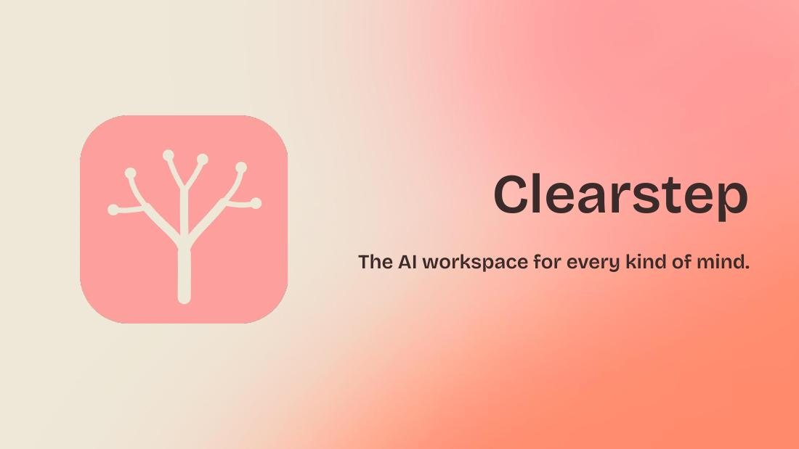
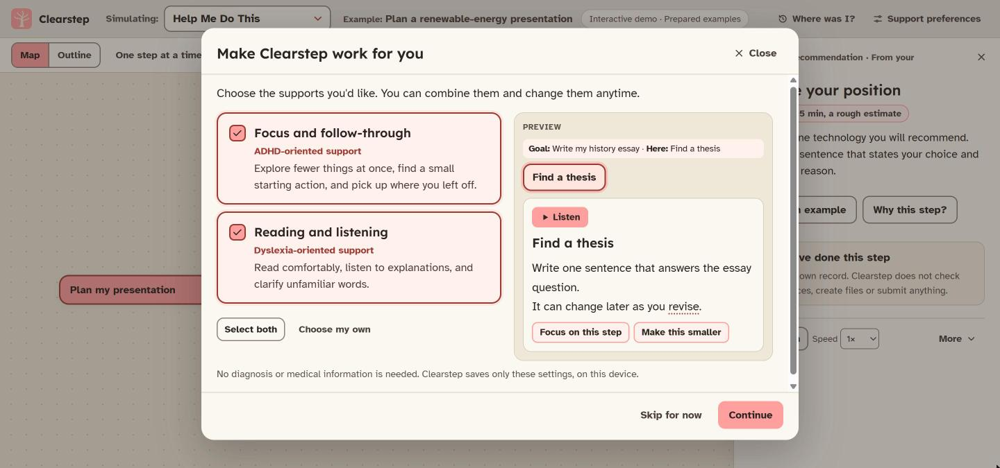
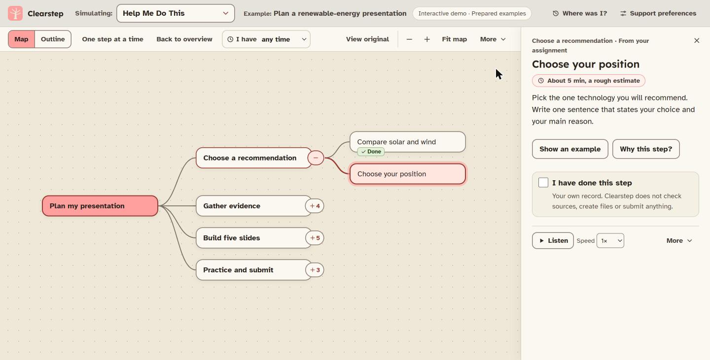
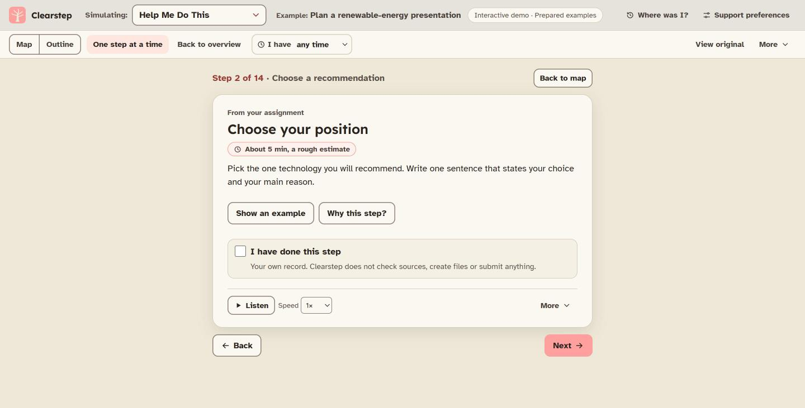
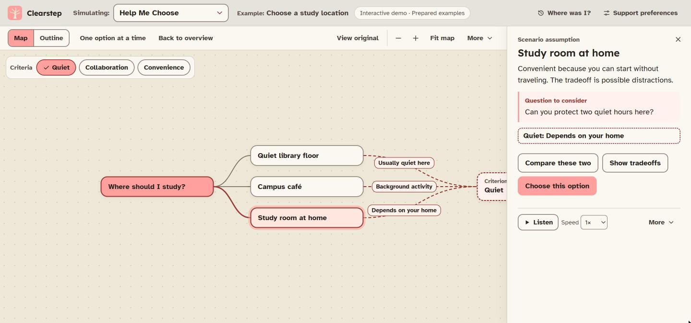

  

  <a href="https://clearstep-ssdemo.vercel.app">Try the live demo</a> ·
  <a href="docs/Clearstep_Pitch_Deck.pdf">Pitch deck (PDF)</a>

# Clearstep

A visual-first AI workspace for students with ADHD and dyslexia. Clearstep turns an assignment, a question, a decision or a messy brain dump into a calm mind map you work through one small step at a time.

Built by Team GTers at HackATL 2026 (Emory Goizueta), October 2026.

## The problem

AI made help instant, but the help still arrives as a wall of text. A student has to reread the brief, decide what to ask, read a long reply, copy it into a planner and find their place again after every interruption. Each of those steps is harder for someone who struggles with reading, planning or getting started.

About 20.5% of U.S. undergraduates report a disability ([NCES](https://nces.ed.gov/programs/digest/d22/tables/dt22_311.10.asp)), and only 37% of students with a disability tell their college ([NCES](https://nces.ed.gov/whatsnew/press_releases/4_26_2022.asp)). So Clearstep never asks for a diagnosis.

## What it does

The whole task is visible at once, detail appears only when you ask for it, and the next step is always small and clear.

| Application | What it helps with | Example in the demo |
|---|---|---|
| Help Me Do This | Breaks an assignment into steps, each tied to the exact sentence it came from | Plan a renewable-energy presentation |
| Help Me Understand This | Explains a concept one idea at a time | Matrix multiplication |
| Help Me Choose | Compares options by what matters to you, with no scores and no "best option" | Choose a study location |
| Help Me Create This | Keeps ideas side by side so your own ideas count as much as the AI's | Explore a startup idea |

There are three ways in: type or paste anything, dump your thoughts in any order, or click a sample prompt. Claude then builds a live map from your words, branch by branch.

## Supports you choose (no diagnosis needed)

On first launch, Clearstep asks which supports you want. You can pick one, both, or mix individual settings.

- Focus and follow-through (ADHD-oriented): Focus here, one branch at a time, "Make this smaller" for a two-minute starting action, an "I have N minutes" filter, and "Where was I?" to resume after interruptions.
- Reading and listening (dyslexia-oriented): a comfortable reading card with adjustable text size and spacing, Listen (read-aloud, including math spoken correctly), and tap-to-explain for unfamiliar words.

## Screenshots

| Choose your supports | Map with step card |
|---|---|
|  |  |
| One step at a time | Help Me Choose |
|  |  |

## Design principles

- Everything is labeled by where it came from: your assignment, your own words, a prepared example, or written by Claude.
- Your words are never silently changed. Brain dump thoughts keep their exact wording.
- No scores, streaks, countdowns, guilt reminders or completion percentages.
- The student makes every choice and ticks every box. Clearstep never claims to check the work.

## How it's built

- React + TypeScript (Vite), built into one self-contained web page
- Live maps generated by Claude, with every line validated before it reaches the map (known fields, max depth, max nodes)
- Browser speech for read-aloud
- Progress saved in the browser, with no login or database
- 93 unit tests and 61 browser tests, including automated WCAG 2.2 AA checks (axe-core)

## Status

Clearstep is a hackathon MVP. It has not been tested with students yet, and its benefits are design hypotheses, not clinical claims. Next steps: a usability study with 6 to 10 students, requirement checking for live maps, and a dedicated backend on the Claude API.
